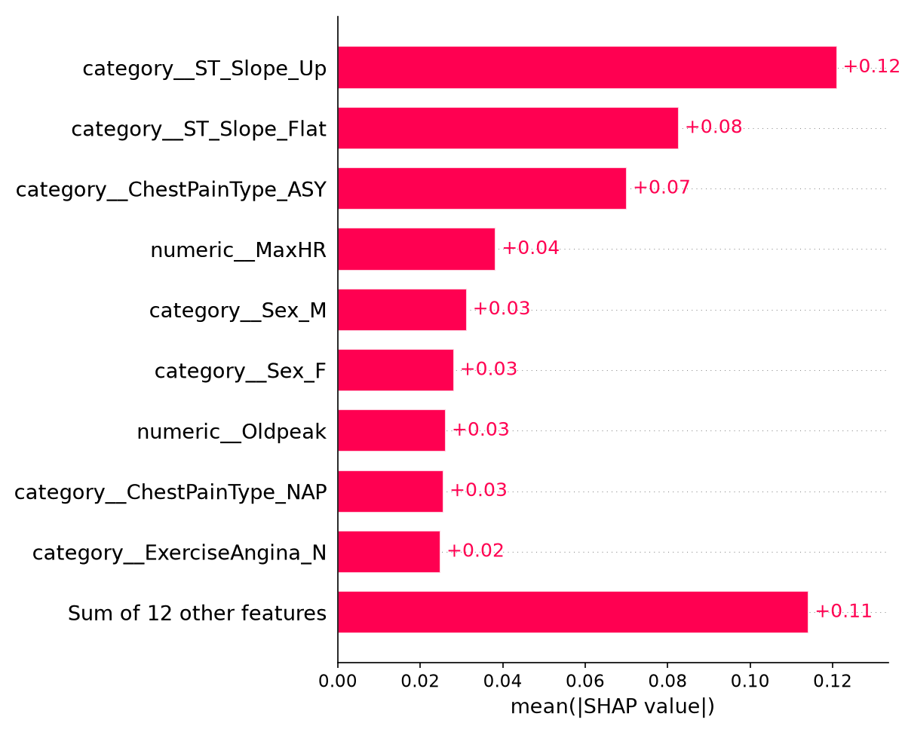

# Heart Disease Prediction Using Machine Learning

This project is a new portfolio implementation of my previous academic project on heart disease prediction, focusing on machine learning, predictive analytics, model evaluation, and explainable AI.
## Dataset
Use the public [Heart Failure Prediction Dataset](https://www.kaggle.com/datasets/fedesoriano/heart-failure-prediction), which describes 918 observations and 11 predictors. Download `heart.csv` and place it in `data/`. The dataset is not bundled; consult its source terms.

## Approach
- Treat zero cholesterol and resting blood pressure as missing; scale numeric features and apply KNN imputation.
- Impute and one-hot encode categorical features; use SMOTE on the training folds only (ordinary SMOTE on encoded categories is a baseline limitation).
- Compare nine classifiers: logistic regression, Gaussian naive Bayes, random forest, gradient boosting, extra trees, decision tree, KNN, SVM and MLP.
- Select the model by five-fold stratified training cross-validation ROC-AUC; report held-out accuracy and ROC-AUC.
- Optionally generate a SHAP feature importance plot for the selected model.

## Run locally (Python 3.11 recommended)
```bash
python3 -m venv .venv
source .venv/bin/activate
pip install -r requirements.txt
mkdir -p data
# Place downloaded heart.csv in data/
python -m src.train --data data/heart.csv --explain
python -m pytest -q
```

## Outputs
The model training pipeline generates the following files:

- `outputs/metrics.csv` - Model performance and evaluation metrics.
- `outputs/model.joblib` - Trained machine learning model.
- `outputs/shap.png` - SHAP feature importance visualization (optional).

Models are evaluated using accuracy, ROC-AUC, and cross-validation scores.

## Model Performance and Results

Nine machine learning classifiers were trained and evaluated using five-fold stratified cross-validation and a held-out test dataset.

| Model | CV ROC-AUC | Test Accuracy | Test ROC-AUC |
|---|---:|---:|---:|
| Random Forest | 0.9265 | 90.22% | 0.9275 |
| Logistic Regression | 0.9215 | 87.50% | 0.9296 |
| Gradient Boosting | 0.9197 | 86.96% | 0.9174 |
| Support Vector Machine | 0.9167 | 87.50% | 0.9394 |
| Extra Trees | 0.9160 | 88.04% | 0.9306 |
| Gaussian Naive Bayes | 0.9098 | 86.41% | 0.9078 |
| K-Nearest Neighbors | 0.8912 | 85.87% | 0.9330 |
| Multilayer Perceptron | 0.8853 | 84.78% | 0.9063 |
| Decision Tree | 0.7959 | 76.09% | 0.7616 |

### Selected Model: Random Forest

Random Forest achieved the highest cross-validation ROC-AUC of 0.9265, with a test accuracy of 90.22% and a test ROC-AUC of 0.9275.

The SVM achieved the highest test ROC-AUC of 0.9394. The MLP reached its maximum iterations before convergence.

[View detailed evaluation metrics](outputs/metrics.csv)

## Explainable AI (SHAP)

SHAP was used to interpret the selected model and identify the features contributing most to its predictions.

ST slope, chest pain type, maximum heart rate, and sex were among the most influential features.



## Automated Testing and Continuous Integration

GitHub Actions is configured to automatically install project dependencies and execute Python unit tests using Pytest whenever changes are pushed to the main branch or submitted through pull requests.

The initial automated testing workflow completed successfully.

## Limitations
- Model performance depends on dataset quality and diversity.
- Potential sampling bias may affect model generalization.
- Further validation is required before real-world clinical implementation.
- This project is intended for educational and research purposes.
